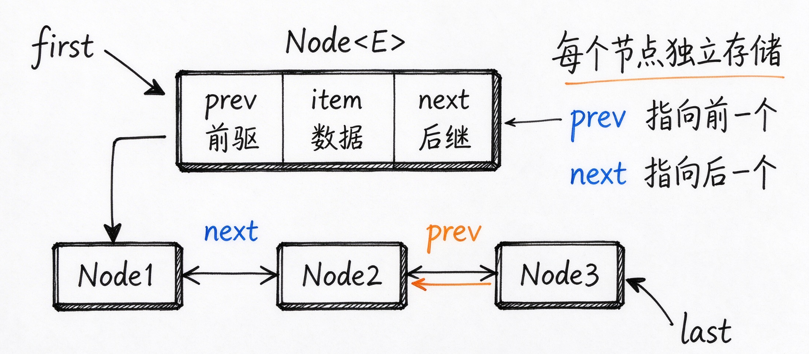

# 12-LinkedList源码与ArrayList对比  
  
## 一、学什么  
  
> 1. 双向链表结构  
> 2. 增删查复杂度  
> 3. 与ArrayList的使用场景对比  
> 4. 缓存局部性  
  
  
  
## 二、做什么  
  
### 2.1 基础知识  
  
**1. LinkedList的底层结构**  
双向链表  
  
```java  
//内部私有静态内部类Node,双向链表节点  
private static class Node<E>{  
    E item; //存储元素  
    Node<E> next;  
    Node<E> prev;  
      
    Node(Node<E> prev,E element,Node<E> next){  
        this.tiem = element,  
        this.next = next;  
        this.prev = prev;  
    }  
}  
  
//成员变量  
transient Node<E> first; //头指针，指向第一个节点  
transient Node<E> last; //尾指针，指向最后一个节点  
transient int size; //当前元素个数  
```  
  
+ 可见本质是双向链表，头尾各有指针，头尾的增删是O(1)  
+ 任意索引需要遍历  
  
**2. 核心方法**  
**(1) add(E e)**  
底层调用`LinkLast(e)`  
  
```java  
public boolean add(E e){  
    LinkLast(e);  
    return true;  
}  
  
void LinkLast(E e){  
    final Node<E> l = last;  
    final Node<E> newNode = new Node<>(l,e,null);  
    last = newNode;  
    if(l == null)  
        first = newNode;  
    else  
        l.next = newNode;  
    size++;  
    modCount++;  
}  
```  
  
**(2) remove(Object o)**  
底层调用`unlink(Node<E> x)`  
  
```java  
E unlink(NOde<E> x){  
    final E element = x.item;  
    final Node<E> next = x.next;  
    final Node<E> prev = x.prev;  
      
    if(prev == null){  
        first = next;  
    }else{  
        prev.next = next;  
        x.prev = null;  
    }  
      
    if(next == null){  
        last = prev;  
    }else{  
        next.prev = prev;  
        x.next = null;  
    }  
      
    x.item = null;  
    size--;  
    modCount++;  
    return element;  
}  
```  
  
**(3) get(int index)**  
  
```java  
public E get(int index){  
    chechElementIndex(index);  
    return node(index).item;  
}  
  
//判断index在前半段还是后半段，从而就近遍历  
Node<E> node(int index){  
    if(index < (size >> 1)){  
        Node<E> x = first;  
        for(int i = 0;i<index;i++)  
            x = x.next;  
        return x;  
    }else{  
        Node<E> x = last;  
        for(int i = size - 1;i>index;i--)  
            x = x.prev;  
        return x;  
    }  
}  
```  
  
**3. LinkedList同时实现List和Deque接口**  
  
```java  
public class LinkedList<E>  
	extends AbstractSequentialList<E>  
	implements List<E>,Deque<E>,Cloneable,Serializable  
```  
  
> LinkedList既是List，又是Deque，所以可充当：  
> 1.List : 普通列表，支持按索引访问、遍历  
> 2.Qeque : 单向队列  
> 3.Deque : 双端队列  
> 4.Stack : 栈  
  
实现队列栈优先 ArrayDeque，而不是 LinkedList  
  
**4. ArrayList与LinkedList内存占用对比**  
ArrayList : 只存元素引用，数组有少量预留容量  
LinkedList : 每个Node是独立对象，对象头+prev+next+item，内存开销远大于ArrayList  
  
**5. 绝大多数场景使用ArrayList**  
  
**(1) 数组内存连续**  
CPU缓存局部性好  
CPU加载内存是按缓存行(64Byte)一次性预加载连续内存  
遍历ArrayList时，后续元素提前进入CPU缓存，缓存命中率高  
LinkedList的Node是分散在堆中的，每个节点都可能触发一次主内存加载，大量cache miss，CPU等待内存，速度下降  
**(2) LinkedList节点额外内存开销大**  
每个Node有：对象头+prev+next，额外占用内存，CPU压力更大  
**(3) ArrayList获取元素更快**  
  
  
  
## 三、实践  
  
**1. 画出 LinkedList 的 Node 结构图**  
  
  
  
**2. 头插为什么是O(1)，随机访问为什么是O(n)**  
  
头插逻辑只修改指针引用，不需要遍历链表  
LinkedList 底层是双向链表，内存不连续，不能像数组那样通过基地址 + 偏移量直接定位元素，需要进行遍历。  
  
**3. 结合缓存局部性说明为什么大部分场景使用ArrayList**  
  
ArrayList 底层数组内存连续，遍历满足 CPU 缓存空间局部性，缓存命中率高；LinkedList 节点离散，大量 cache miss，遍历慢，同时随机访问需要线性遍历 O (n)。  
**空间局部性**：如果一个数据被访问，那么它附近相邻的数据，很大概率马上也会被访问。  
  
  
  
## 四、问题  
  
**1. ArrayList和LinkList的区别**  
  
ArrayList 底层动态数组，内存连续，随机访问 O (1)；插入删除可能移动元素。  
LinkedList 双向链表，节点分散，节点带 prev、next 指针；两端增删 O (1)，随机访问 O (n)，内存开销更大。ArrayList 缓存友好，遍历更快。  
  
**2. 什么场景使用LinkedList**  
  
适合频繁首尾增删、几乎不按索引查询的场景；它实现 Deque 可以做双端队列。  
但是队列栈优先 ArrayDeque，LinkedList 很少用。  
  
**3. LinkedList的get为什么慢**  
  
LinkedList 没有数组的偏移寻址，get 要调用 node 方法，根据索引在前半段还是后半段，从头或尾线性遍历节点，是 O (n)，所以慢。  
